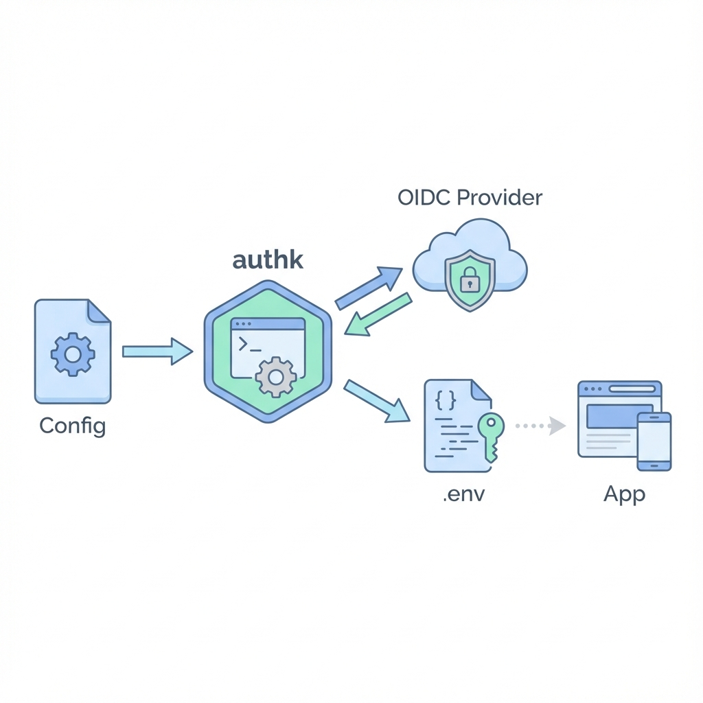

# authk

[](https://goreportcard.com/report/github.com/codozor/authk)

[](https://coveralls.io/github/codozor/authk)


`authk` is a CLI tool designed to establish and maintain an OIDC connection. It automatically updates a `.env` file with a valid access token, ensuring your development environment always has fresh credentials.
 


## Features

- **OIDC Integration**: Client Credentials and Resource Owner Password Credentials flows, with an explicit `flow` per profile.
- **Profiles**: several identities (realms, clients, users) in a single config file.
- **Automatic Refresh**: an agent renews tokens before they expire and serves them to `authk get`.
- **.env Management**: updates keys of `.env` files with the new tokens.
- **Configurable**: uses CUE for flexible and type-safe configuration, with secrets from env, files, SOPS or Kubernetes.

## Installation

```bash
go install github.com/codozor/authk/cmd/authk@latest
```

Or build from source:

```bash
git clone https://github.com/codozor/authk.git
cd authk
go build -o authk ./cmd/authk
```

## Configuration

`authk` uses a CUE configuration file (default: `authk.cue`) holding one or more **profiles**. Each profile is an OIDC client, the **flow** used to get its tokens, and the files to write them to.

```cue
package config

version: 2

profiles: dev: {
	issuerUrl: "https://kc.example.com/realms/dev"
	clientId:  "my-client"
	client: {
		method: "client_secret_basic" // or "client_secret_post", or "none" for a public client
		secret: "ref+env://KC_CLIENT_SECRET"
	}
	flow: type: "client_credentials"
	// scopes: ["openid", "profile", "email"] // default
	targets: [{file: ".env", key: "TOKEN"}]
}
```

### Flows

| `flow.type` | Fields | Notes |
|---|---|---|
| `client_credentials` | — | Requires a client secret. |
| `password` | `username`, `password` | Resource Owner Password Credentials. Keycloak: enable *Direct access grants* on the client. |
| `device_code` | — | Accepted in the config; not implemented yet. |

### Profiles

```cue
version: 2
defaultProfile: "dev" // optional

profiles: dev: { ... }
profiles: prod: { ... }
```

The profile is chosen with `--profile` (`-p`), else `$AUTHK_PROFILE`, else `defaultProfile`, else the only profile of the file. `authk config profiles` lists them.

Secrets are resolved only for the selected profile: a `prod` secret stored in Kubernetes is not read when you use `dev`.

### Writing tokens

Each target writes a token to a key of a file:

```cue
targets: [
	{file: ".env", key: "MY_ACCESS_TOKEN"}, // type: "access_token" by default
	{file: ".env", key: "MY_ID_TOKEN", type: "id_token"},
	{file: "apps/frontend/.env", key: "API_TOKEN"},
]
```

Relative `file` paths are resolved against the directory of the configuration file, so running `authk` from a subdirectory updates the same files.

Without `targets`, the token is written to the `.env` file found from the current directory (see [File Discovery](#file-discovery)) or given with `--env`, under the keys of `envKeys`:

```cue
envKeys: {
	accessToken: "TOKEN" // default
	idToken:     "ID_TOKEN" // optional
}
```

`.env` files are written atomically (temporary file + rename): readers never see a partially written file. An existing file keeps its permissions and a symlink is followed; a file created by `authk` gets `0600` permissions since it holds a token.

### Version 1 files

Files without `version` (the format of authk 1.x) keep working: they are converted in memory into a single profile named `default`. To rewrite such a file in the version 2 format:

```bash
authk config migrate --dry-run  # print the result
authk config migrate            # rewrite authk.cue, keeping authk.cue.v1.bak
```

Comments are not kept; secret references are copied as they are, never resolved.

## Configuration Examples

### Keycloak (password flow)

```cue
package config

version: 2

profiles: dev: {
	issuerUrl: "https://keycloak.example.com/realms/myrealm"
	clientId:  "my-client"
	client: secret: "ref+env://KC_CLIENT_SECRET"
	flow: {
		type:     "password"
		username: "myuser"
		password: "ref+env://KC_PASSWORD"
	}
}
```

### Keycloak (public client)

For a Keycloak client with *Client authentication* turned off, set `method: "none"` (or omit the secret). The `client_id` is then sent in the request body without secret. A public client cannot use the Client Credentials flow, and *Direct access grants* must be enabled for the password flow.

```cue
profiles: dev: {
	issuerUrl: "https://keycloak.example.com/realms/myrealm"
	clientId:  "my-public-client"
	client: method: "none"
	flow: {type: "password", username: "myuser", password: "ref+env://KC_PASSWORD"}
}
```

### Authentik

```cue
profiles: dev: {
	issuerUrl: "https://authentik.example.com/application/o/my-app/"
	clientId:  "my-client-id"
	client: secret: "ref+env://AUTHENTIK_CLIENT_SECRET"
	flow: type: "client_credentials"
	scopes: ["openid", "profile", "email", "goauthentik.io/api"]
}
```

## Secrets Management

`authk` integrates with [vals](https://github.com/helmfile/vals) to support loading secrets securely from various sources. You can use special URI schemes in your configuration file to reference secrets instead of hardcoding them.

Supported schemes:
*   `ref+env://VAR` - Environment variables
*   `ref+file:///path/to/file` - File contents
*   `ref+sops://path/to/file.yaml#/key` - Files encrypted with [SOPS](https://github.com/getsops/sops)
*   `ref+k8s://v1/Secret/<namespace>/<name>/<key>` - Kubernetes Secrets (`?kubeContext=...` to choose a context)

```cue
client: secret: "ref+env://OIDC_CLIENT_SECRET"
client: secret: "ref+file:///path/to/secret_file"
flow: password: "ref+k8s://v1/Secret/default/my-secret/password"
```

## File Discovery

The configuration file (`authk.cue`) is searched in the following order:

1.  **Explicit Path**: If provided via `--config`.
2.  **Current Directory**: Checks the current working directory.
3.  **Parent Directories**: Walks up the directory tree to the root.
4.  **Home Directory**: Checks the user's home directory (`$HOME`).

This allows you to run `authk` from any subdirectory within your project or rely on a global configuration in your home directory.

When the config has no `targets`, the `.env` file is found as follows:

- **Explicit path** (`--env front/.env`): used as is, relative to the current directory.
- **Project config** (not in the home directory root): searched from the current directory up to the config directory, never above. If none is found, it is created next to the config.
- **Global config** (`~/authk.cue`): searched from the current directory up to, but excluding, the home directory. If none is found, it is created in the current directory.

`~/.env` is never used implicitly: a project without `.env` must not write its token there, nor share it with every other project.

## Usage

### Agent (Long-running)

This is the main mode. The agent fetches a token, updates the `.env` file (or the configured targets), and keeps running to renew the token before it expires. It stops cleanly on `Ctrl+C` or `SIGTERM`.

```bash
./authk agent             # in the foreground
./authk agent --detach    # in the background (-d)
```

While the agent runs, `authk get` and `authk inspect` use its current token through a local socket instead of authenticating again. The agent is the only process that renews the token, which matters with refresh token rotation (Keycloak *Revoke Refresh Token*).

An agent serves one profile of a config file, and one `.env` file when the profile has no `targets` (`--env` is ignored, with a warning, when the profile defines `targets`). Several agents can run at the same time; a second agent for the same files is refused.

```bash
./authk agent list          # list running agents (alias: ls, --json available)
./authk agent status [ID]   # show an agent state (--json available)
./authk agent refresh [ID]  # renew the token now
./authk agent logs [ID] -f  # follow the logs of a detached agent
./authk agent stop [ID]     # stop an agent
./authk agent stop --all    # stop every agent
```

Without ID, these commands act on the agent serving the current directory. An ID prefix is enough, as with Docker.

```
$ authk agent list
ID                 PID    STARTED           TOKEN  MODE        CONFIG                 WRITES
281028a4-b3def358  31337  2026-11-06 09:12  4m12s  detached    ~/dev/app/authk.cue    ~/dev/app/front/.env
281028a4-05a23f95  31420  2026-11-06 09:13  4m30s  detached    ~/dev/app/authk.cue    ~/dev/app/back/.env
d4a4eba5           31502  2026-11-06 09:30  1m58s  foreground  ~/dev/other/authk.cue  ~/dev/other/out/.env
```

`--detach` returns once the agent has its first token, or prints its log if it fails to start. Logs of detached agents are written to `$XDG_STATE_HOME/authk/logs` (default `~/.local/state/authk/logs`) and kept 7 days.

Sockets and registrations live in `$XDG_RUNTIME_DIR/authk/` (or a private directory in the system temp dir); set `AUTHK_SOCK` to use a specific socket path.

> Running `authk` without a command still starts the agent in the foreground, but is deprecated.

**Flags:**
- `--config`: Path to config file (default: `authk.cue`)
- `--profile`, `-p`: Profile to use (default: `$AUTHK_PROFILE`, `defaultProfile`, or the only profile)
- `--env`: Path to .env file (default: `.env`), when the profile has no `targets`
- `--detach`, `-d`: Run in the background
- `--debug`: Enable debug logging

### Get Token (One-off)

Prints a valid token to stdout. Useful for piping to other commands.

```bash
./authk get
curl -H "Authorization: Bearer $(./authk get)" https://api.example.com
```

If an agent serves the config, its current token is printed (renewed first if it expires within `--min-ttl`). Otherwise a new token is requested from the provider. If the agent runs but fails, `get` returns its error instead of authenticating on its own.

When several agents serve the config (one per `.env` file), `get` uses the one writing the `.env` file found from the current directory, or given with `--env`; if none matches, it fails and lists them. Set `AUTHK_SOCK` to target a specific agent.

**Flags:**
- `--id-token`: Print ID Token instead of Access Token
- `--min-ttl`: Minimum remaining validity of a token served by the agent (default: `10s`)
- `--no-agent`: Always request a new token, even if an agent runs

### Inspect Token

Displays the decoded content (Header and Payload) of the current token, with its source and expiry.

If an agent runs, its current token is inspected. Otherwise, or with `--from-env` or `--env`, the token is read from the `.env` file, which shows what applications actually read. It automatically uses the file and key defined in your `targets` if available.

```bash
./authk inspect
```

**Flags:**
- `--id-token`: Inspect the ID token instead of the Access token (searches for a target of type `id_token`)
- `--from-env`: Read the token from the `.env` file even if an agent runs
- `--env`: Path to .env file. If multiple targets exist for different files, use this to specify which one to inspect (implies `--from-env`).
- `--json`: Output as valid JSON without colors (useful for parsing). Includes a `source` field (`agent` or `env`).

## License

MIT
